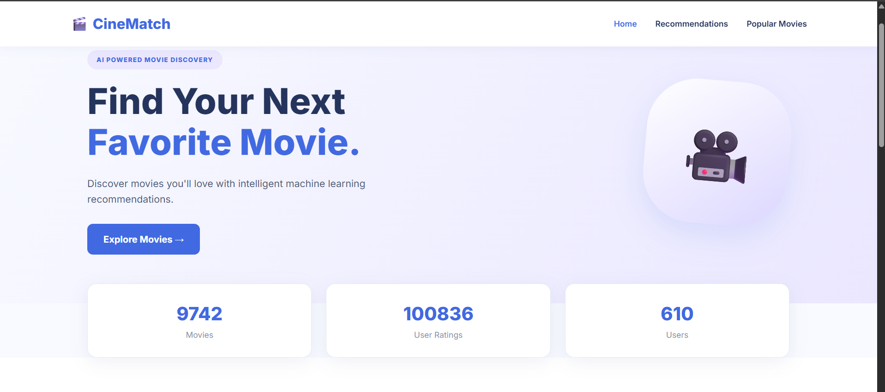
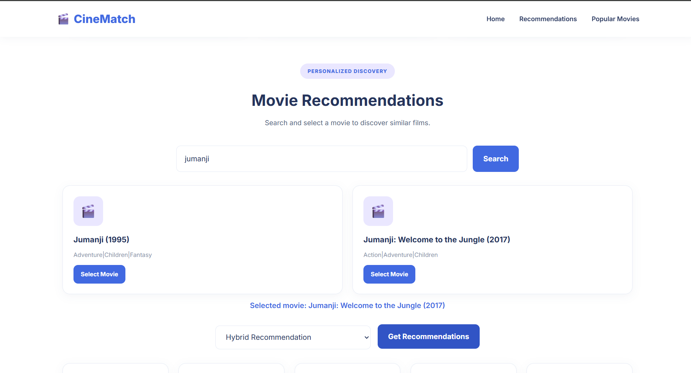
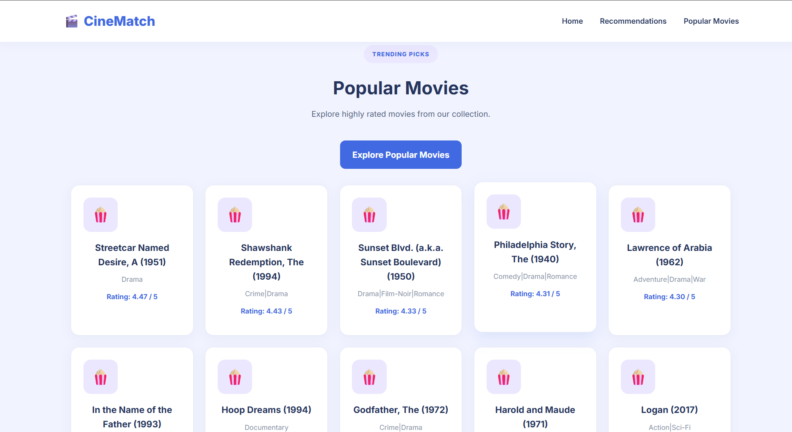
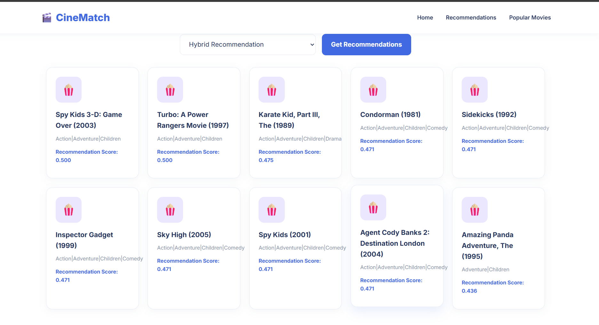

# 🎬 CineMatch – Movie Recommendation System

A Machine Learning-based Movie Recommendation System that helps users discover movies based on their interests, genres, and user-rating patterns.

CineMatch combines **Content-Based Filtering, Collaborative Filtering, and Hybrid Recommendation** techniques to generate personalized movie recommendations through an interactive Flask web application.

---

## 📌 Project Overview

Finding movies that match individual preferences can be difficult when there are thousands of options available.

CineMatch solves this problem by analyzing movie genres and user-rating patterns to recommend relevant movies.

The project includes an interactive website where users can search for movies, select a recommendation algorithm, and explore suggested movies.

## ✨ Features

- 🔍 **Movie Search:** Search movies by title.
- 🎯 **Content-Based Filtering:** Recommends movies with similar genres and characteristics.
- 👥 **Collaborative Filtering:** Uses movie-rating patterns and item-based KNN to find similar movies.
- ✨ **Hybrid Recommendation:** Combines content-based and collaborative recommendation techniques.
- ⭐ **Popular Movies:** Displays popular movies based on average ratings and rating counts.
- 🌐 **Interactive Website:** User-friendly web interface developed using HTML, CSS, JavaScript, and Flask.

## 🧠 Machine Learning Algorithms

### 1. Content-Based Filtering
- Uses movie genres and metadata.
- Converts textual features into numerical representations using TF-IDF.
- Calculates cosine similarity between movies.
- Recommends movies with similar characteristics.

### 2. Collaborative Filtering
- Uses user-movie rating data.
- Applies item-based K-Nearest Neighbors (KNN).
- Identifies movies with similar user-rating patterns.
- Generates recommendations based on similar movies.

### 3. Hybrid Recommendation
- Combines content-based and collaborative recommendations.
- Uses recommendation scores to rank candidate movies.
- Provides recommendations using multiple sources of information.

## 🛠️ Technologies Used

| Technology | Purpose |
|---|---|
| Python | Core programming |
| Pandas | Data manipulation |
| NumPy | Numerical computations |
| Scikit-learn | Machine Learning algorithms |
| Flask | Backend web framework |
| HTML | Website structure |
| CSS | Website styling |
| JavaScript | Frontend interactions |
| Matplotlib | Data visualization |
| Seaborn | Data visualization |
| Jupyter Notebook | Data analysis and experimentation |

## 📂 Project Structure

```text
Movie-Recommendation-System/
│
├── app.py
├── requirements.txt
├── README.md
├── .gitignore
├── create_notebook.py
│
├── dataset/
│   ├── movies.csv
│   └── ratings.csv
│
├── models/
│   ├── knn_model.pkl
│   ├── movie_data.pkl
│   ├── similarity_matrix.pkl
│   ├── tfidf_vectorizer.pkl
│   └── user_movie_matrix.pkl
│
├── notebooks/
│   └── movie_recommendation_analysis.ipynb
│
├── src/
│   ├── __init__.py
│   ├── data_preprocessing.py
│   ├── content_based.py
│   ├── collaborative_filtering.py
│   ├── recommendation_engine.py
│   └── model_evaluation.py
│
└── templates/
    └── index.html
```

## 📊 Dataset

The project uses the MovieLens dataset.

The dataset contains:

- `movies.csv`: Movie IDs, titles, and genres.
- `ratings.csv`: User IDs, movie IDs, ratings, and timestamps.

Dataset source:

[MovieLens – GroupLens Research](https://grouplens.org/datasets/movielens/)

The dataset used in this project contains approximately:

- 9,742 movies
- 100,836 user ratings
- 610 users

## ⚙️ Installation and Setup

### Step 1: Clone the repository

```bash
git clone YOUR_GITHUB_REPOSITORY_URL
```

### Step 2: Navigate to the project folder

```bash
cd Movie-Recommendation-System
```

### Step 3: Create a virtual environment

```bash
python -m venv venv
```

### Step 4: Activate the virtual environment

Windows:

```bash
venv\Scripts\activate
```

### Step 5: Install dependencies

```bash
pip install -r requirements.txt
```

### Step 6: Run the application

```bash
python app.py
```

### Step 7: Open the website

Visit:

```text
http://127.0.0.1:5000
```

## 🚀 How to Use CineMatch

1. Open the CineMatch website.
2. Enter a movie title in the search box.
3. Click the Search button.
4. Select a movie from the search results.
5. Choose a recommendation algorithm:
   - Hybrid Recommendation
   - Content-Based Filtering
   - Collaborative Filtering
6. Click Get Recommendations.
7. Explore the recommended movies.
8. Visit the Popular Movies section to discover popular titles.

## 📈 Model Evaluation

The project includes an evaluation module to measure rating-prediction error and recommendation quality.

The evaluation uses:

- Mean Absolute Error (MAE)
- Root Mean Squared Error (RMSE)
- Precision@10
- Recall@10

Run the evaluation using:

```bash
python -m src.model_evaluation
```

**Note:** MAE and RMSE in the current evaluation are calculated using a user-average rating baseline. Precision@10 and Recall@10 evaluate the item-based KNN recommendation approach. These metrics measure different aspects of the system and should not be interpreted as the performance of every algorithm.

## 🔮 Future Improvements

- Display actual movie posters.
- Add movie descriptions and release dates.
- Improve recommendation quality through additional algorithms.
- Add user login and personalized watchlists.
- Deploy the application online.
- Improve recommendation evaluation using additional metrics.

## 👩‍💻 Project Information

**Project Name:** CineMatch – Movie Recommendation System

**Domain:** Machine Learning

**Category:** Recommendation Systems

**Framework:** Flask

**Language:** Python

## 🙏 Acknowledgements

- [GroupLens Research](https://grouplens.org/) for the MovieLens dataset.
- [Scikit-learn](https://scikit-learn.org/) for machine learning tools.
- [Flask](https://flask.palletsprojects.com/) for web application development.

## Screenshots

### Homepage


### Movie Search


### Popular Movies


### Recommendations
